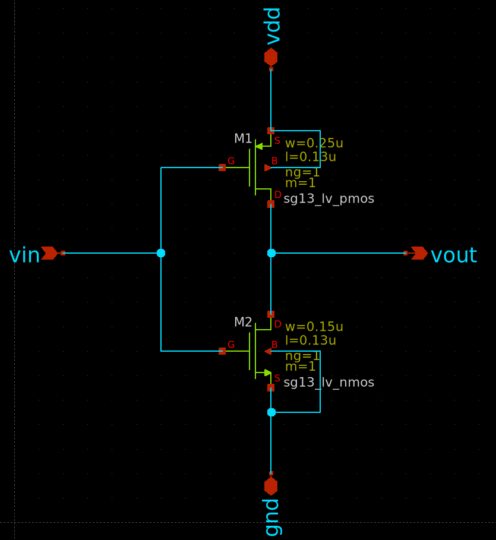
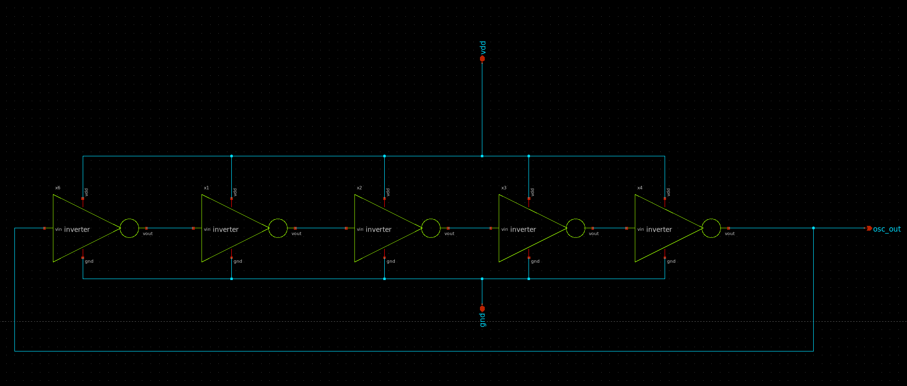
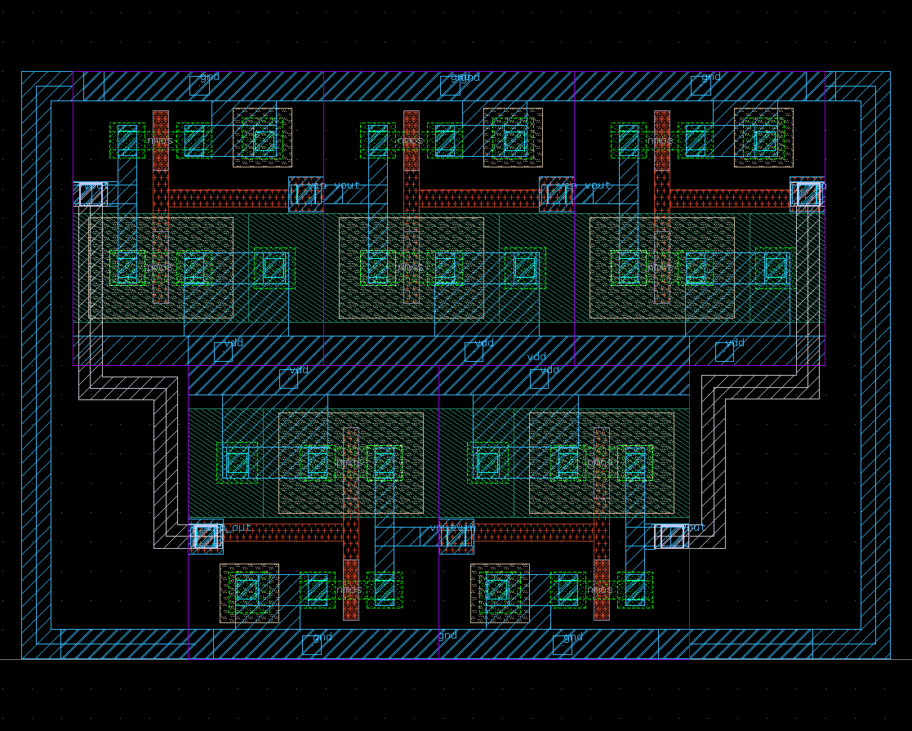
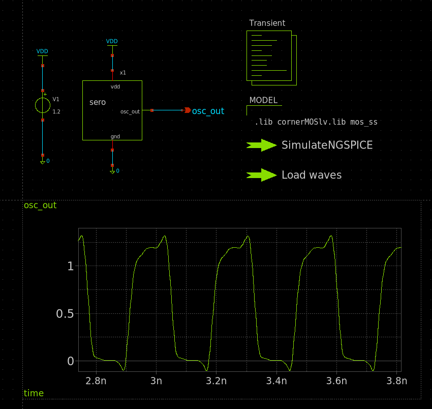
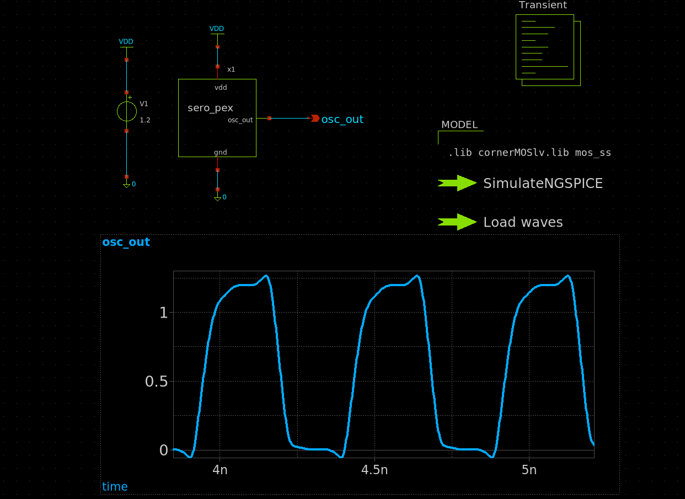
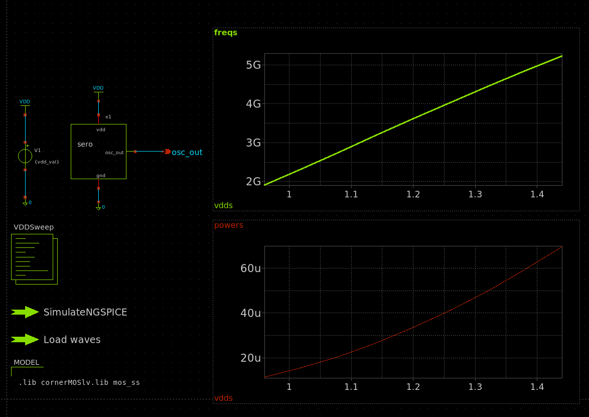
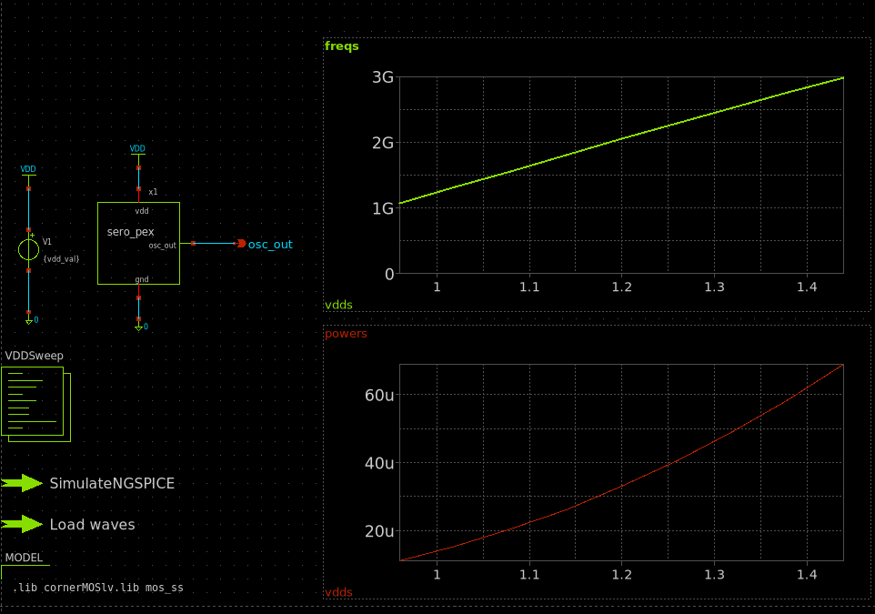

# 5-Stage CMOS Single Ended Ring Oscillator (IHP SG13G2)

Design, simulation, and layout of a single-ended ring oscillator (SERO), following the design procedure in:

> E. Zafarkhah, M. Maymandi-Nejad, M. Zare, "Single-ended ring oscillators: analysis and design," *IET Circuits, Devices & Systems*, 14(6), 2020.

Implemented on the open-source [IIC-OSIC-Tools](https://github.com/iic-jku/iic-osic-tools) Docker flow, targeting the IHP `sg13g2` 130 nm open-source PDK.

## Flow

Sized a 5-stage inverter ring per the SERO procedure to target a specific oscillation frequency in xschem and verified startup and oscillation frequency pre-layout in ngspice. Following which the layout was drawn using Klayout and DRC and LVS run was performed through the built-in macros in Klayout as well as the scripts provided in the docker.

### Design

The ring oscillator is built from a chain of 5 CMOS inverter stages, closed into a loop.

Full SERO schematic (xschem):

### Layout

Layout drawn in KLayout, verified with DRC/LVS:

### Simulation Results

**Transient response — pre-layout (schematic) vs. post-layout (PEX):**

**Frequency vs. supply voltage (VDD):**

## Result

Post-layout frequency came in noticeably below the schematic estimate(~ 40% reduction), intially a linear chain topology was used, then a circular topology was implemented which resulted in about 85MHz of gain in frequency.
The following table shows the frequency in the typical(TT) and the slow(SS) corners. 

| Corner | Frequency |
|---|---|
| TT | 2.60 GHz |
| SS | 1.98 GHz |

## Limitations found

- **~24% frequency spread between SS and TT** — inherent to a plain (uncompensated) ring at this device size; not fixable through layout alone.
- **Layout-induced parasitic loss**, on top of the corner spread: initial placement (all 5 stages in a single row) forced the ring's closing connection to run the full length of the row, ~4× longer than any other inter-stage wire — traced directly from PEX netlist/extraction coordinates, then fixed with a folded (2-row) placement, recovering ~3.2–3.3% frequency at both corners.

## Next steps

To hold a fixed target frequency across PVT rather than accepting the ~24% spread:
- Current-starved inverter stages (controllable drive current instead of an implicit function of V_DD/process)
- Bandgap-referenced bias + LDO for temperature/supply compensation

